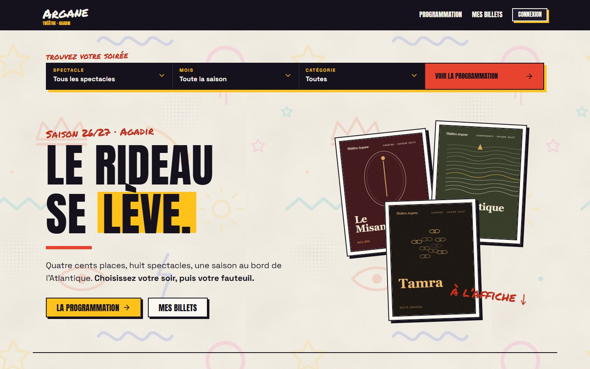
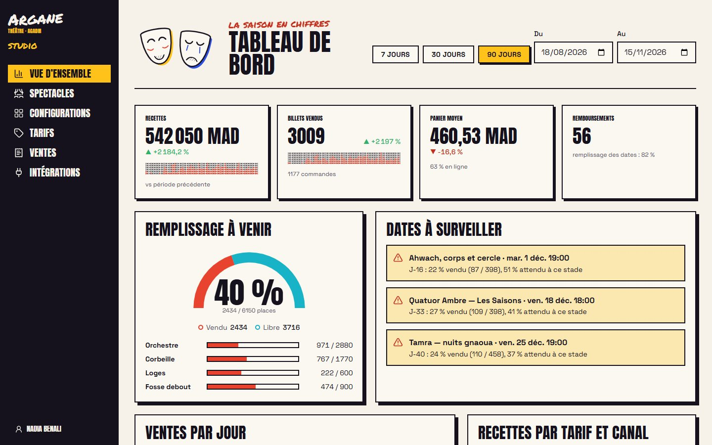
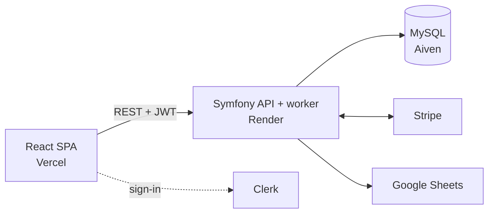

# Théâtre Argane — Billetterie

Ticketing for a 400-seat theatre in Agadir: live seat map, Stripe payments, QR tickets, door check-in, and a back office with a BI dashboard.

**Live demo → https://argane-five.vercel.app**

| Role | Sign in with (code `424242`) |
|---|---|
| Spectator | `client+clerk_test@example.com` |
| Organizer (Studio, box office, check-in) | `organisateur+clerk_test@example.com` |
| Box-office staff (no Studio) | `guichet+clerk_test@example.com` |

Test card `4242 4242 4242 4242`, any future date, any CVC. The free API sleeps when idle: the first load can take a minute.

| | |
|---|---|
|  |  |
|  |  |

## Features

| Who | Can |
|---|---|
| Spectator | Browse shows, pick seats (10-min hold), pay, get QR tickets (PDF + email), cancel up to 48 h before |
| Box office | Sell at the counter (cash, card, invitations), refund, scan tickets with a phone |
| Organizer | Shows, dates, posters, prices, hall seats; cancel a date with automatic refunds; BI dashboard, CSV, Google Sheets |

## How it works



- **No double booking:** a hold is one conditional SQL `UPDATE`; a unique index is the last guard. Tested with real parallel processes.
- **Reliable payments:** Stripe webhook *and* reconcile-on-read, under a row lock; a late payment whose seats are gone is refunded.
- **Signed tickets:** QR `ARG1.<id>.<HMAC>`, no personal data, admitted once.
- **Modular monolith:** 12 Symfony modules; boundaries enforced by a test.
- **Tested:** 380 backend tests (PHPStan level 8), 105 frontend tests, Playwright purchase test against the live site, CI on every push.

## Stack

Symfony 7.4 · PHP 8.3 · FrankenPHP · MySQL 8 · Messenger · React 19 · TypeScript · Vite · Tailwind v4 · TanStack Query · Clerk · Stripe · Docker · Render · Aiven · Vercel

## Run locally

```sh
make up && make fixtures   # http://localhost:5173
```

Keys and deployment: [INSTALL.md](INSTALL.md).

## Docs

| Doc | What's in it |
|---|---|
| [Architecture](docs/ARCHITECTURE.md) | Diagrams: system, modules, purchase flow, jobs, data model, deployment |
| [Decisions](docs/DECISIONS.md) | 15 short records: decision, why, trade-off |
| [Challenge answers](docs/CHALLENGE.md) | The five business questions of the brief |
| [Install](INSTALL.md) | Local setup, keys, tests, free-tier deployment |
| [Build brief](docs/BRIEF.md) | Archive: the original spec used to drive the build |
| [AI traces](docs/ai-traces/) | How the project was built with Claude Code |
