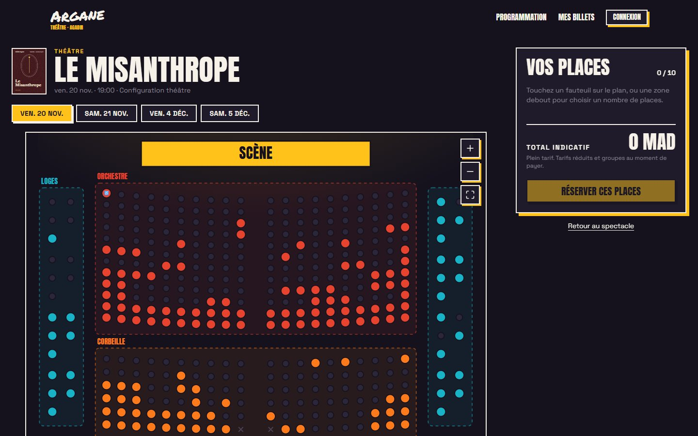
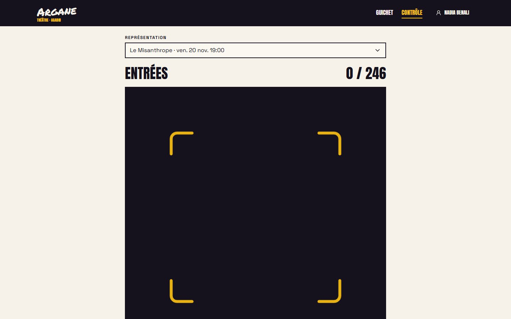

# Théâtre Argane — Billetterie

Online and box-office ticketing for a 400-seat theatre in Agadir: seat maps, Stripe
payments, QR tickets, door check-in and a BI dashboard for the organizer.

**Live demo → https://argane-five.vercel.app**

| Role | Sign in with (code `424242`) |
|---|---|
| Spectator | `client+clerk_test@example.com` |
| Organizer (Studio, box office, check-in) | `organisateur+clerk_test@example.com` |
| Box-office staff (box office and check-in only, no Studio) | `guichet+clerk_test@example.com` |

Test card `4242 4242 4242 4242`, any future date, any CVC. The API runs on a free plan
and sleeps when idle, so the first load can take up to a minute.

| | |
|---|---|
|  |  |
|  |  |

## Features

- **Spectators:** browse the season, pick seats on a live hall plan (10-minute hold),
  pay with Stripe, get QR tickets by PDF and email, cancel with automatic refund.
- **Box office:** sell at the counter (cash, card, invitations), refund, scan tickets
  at the door with a phone camera.
- **Organizer:** manage shows, dates, hall layouts and price grids; cancel a date with
  automatic refunds and emails; BI dashboard; CSV export; live Google Sheets sync.

## Engineering highlights

- **No double booking.** Seat holds and sales are conditional row updates under InnoDB
  locks, backed by a unique index; two buyers racing for a seat get a clean `409`.
- **Reliable payments.** Idempotent Stripe webhooks, reconciliation when an order is
  read, row locking so the webhook and the browser never settle one payment twice,
  automatic refund when a late payment loses its seats.
- **Tamper-proof tickets.** QR payload `ARG1.<id>.<HMAC>`, no personal data; a ticket
  is admitted once even with two doors scanning at the same moment.
- **Modular monolith.** Symfony modules (Venue, Catalog, Pricing, Booking, Payment,
  Identity, Integration) with boundaries enforced by architecture tests.
- **Tested.** 365 backend tests (PHPUnit, PHPStan level 8), 90 frontend tests (Vitest),
  Playwright end-to-end purchase run against the live site; GitHub Actions CI.
- **Accessible.** Keyboard and screen-reader friendly seat map, reduced-motion support.

## Stack

Symfony 7.4 · PHP 8.3 · FrankenPHP · MySQL 8 · Messenger + Scheduler ·
React 19 · TypeScript · Vite · Tailwind v4 · TanStack Query · Clerk · Stripe ·
Docker · Render · Aiven · Vercel

## Run locally

```sh
make up && make fixtures   # then open http://localhost:5173
```

Keys and full setup: [INSTALL.md](INSTALL.md).

## Docs

- [Architecture](docs/ARCHITECTURE.md) · [Decision records](docs/DECISIONS.md)
- [Product and build brief](docs/BRIEF.md): scope, business rules, design system, slice plan
- [AI traces](docs/ai-traces/): how the project was built with Claude Code
