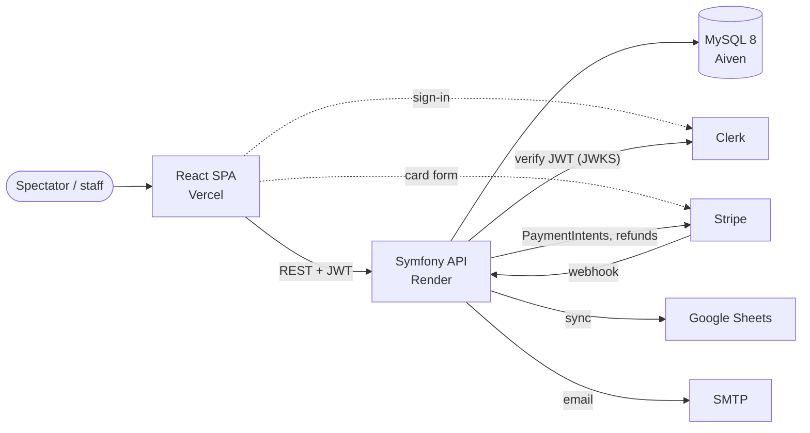
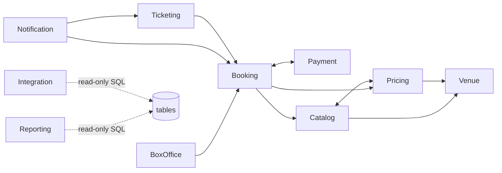
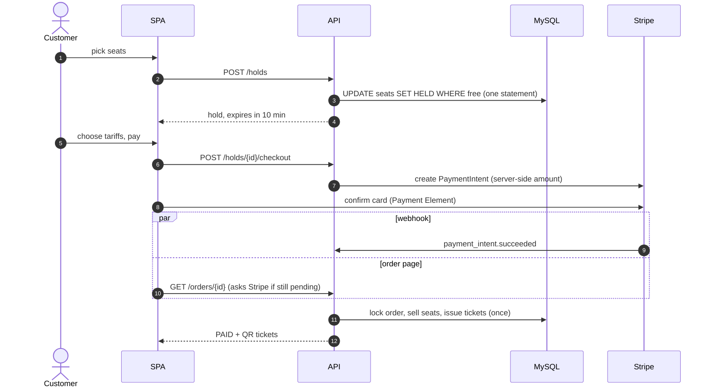
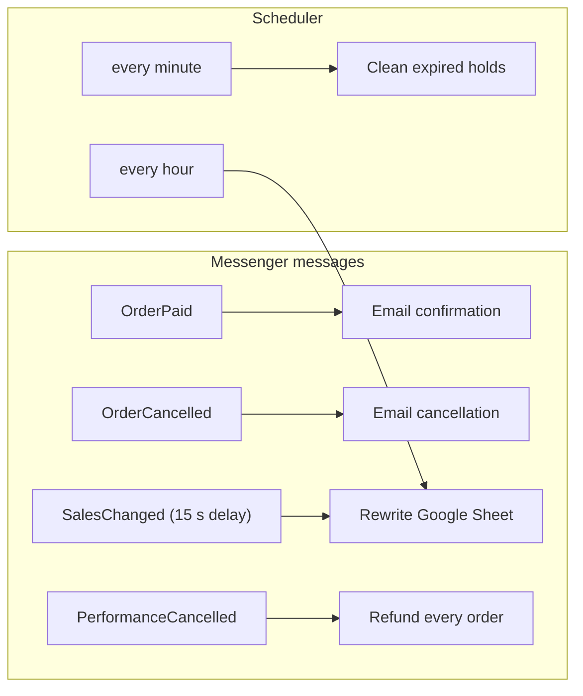
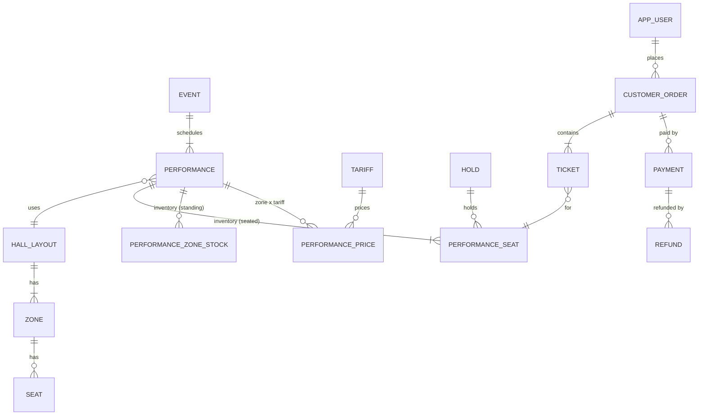
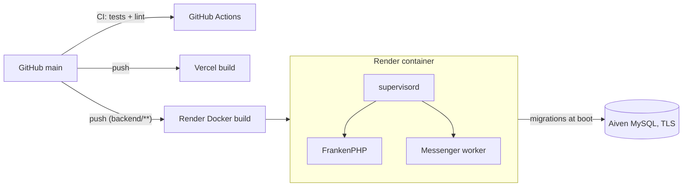

# Architecture

A **modular monolith** (Symfony 7.4) behind a **React SPA**, on free hosting.

- [System](#system)
- [Backend modules](#backend-modules)
- [Buying a seat](#buying-a-seat)
- [Background work](#background-work)
- [Data model](#data-model)
- [Frontend](#frontend)
- [Deployment](#deployment)
- [Conventions](#conventions)

## System



The browser never talks to the database or holds a secret: Clerk issues a session JWT, the API checks it locally, and roles live in our database.

## Backend modules



Arrows are real `use` imports (Identity and Shared, used by most modules, are left out).

| Module | Owns |
|---|---|
| Venue | Hall, two set-ups (Théâtre, Concert), zones, seats |
| Catalog | Shows, dates, per-date seat inventory, posters |
| Pricing | Tariffs, price grid, who may sell which tariff |
| Booking | Holds, orders, tickets, cancellations |
| BoxOffice | Counter sales and refunds |
| Payment | Stripe gateway, webhooks, refunds |
| Ticketing | Signed QR codes, PDF tickets, check-in |
| Reporting | Dashboard and sales queries, CSV |
| Integration | Google Sheets sync |
| Notification | Emails |
| Identity | Users, roles, Clerk JWT authenticator |
| Shared | Money, venue time, errors, health |

Each module has the same layers:

```
Domain/          entities, value objects, repository interfaces (no framework)
Application/     use cases, queries, DTOs, policies, messages
Infrastructure/  Doctrine and DBAL repositories, external clients
Api/             thin controllers
```

**Rule, enforced by a test** (`ModuleBoundariesTest`): a module may use another module's `Domain` and `Application`, never its `Infrastructure` or `Api`.

## Buying a seat



- **No double sale:** the hold is one conditional `UPDATE`; a unique index on active tickets is the last guard. A real multi-process test proves it.
- **No stuck payment:** the webhook and the order page both settle the order; a row lock makes sure only one does.
- **Late payment:** if the hold expired and the seat was taken meanwhile, the payment is refunded automatically.

## Background work



Correctness never waits for the worker: an expired hold already counts as free in every query.

## Data model



A ticket copies its price, tariff and seat at sale time, so later price changes never alter it.

## Frontend

React 19, Vite, TypeScript (strict), Tailwind v4, TanStack Query.

```
src/app/            routes, layouts, auth (Clerk)
src/pages/          one file per route
src/features/       catalog, seatmap, checkout, wallet, studio, box office, check-in
src/design-system/  tokens, primitives (Button, Select, DatePicker…), components
src/lib/            API client, generated OpenAPI types, formatting
```

API types are generated from the backend's OpenAPI document, so a contract change breaks the build.

## Deployment



One container runs the web server and the worker, because Render's free plan has no separate workers. Free instances sleep after 15 minutes; the SPA shows a waiting screen during the cold start.

## Conventions

| Topic | Rule |
|---|---|
| Errors | `application/problem+json` with a stable `code` (`SEAT_UNAVAILABLE`, `HOLD_EXPIRED`…) |
| Money | Integer cents + currency, never floats |
| Time | Stored UTC, shown in `Africa/Casablanca`; services take a `ClockInterface` |
| IDs | UUID v7; orders also get a readable reference (`ARG-26-001268`) |
| API docs | OpenAPI at `/api/doc.json` |
